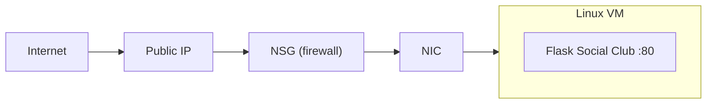

# GTA 6 DevOps Academy — Mission 1: The Vanilla Deployment

> It's launch day for the *Rockstar Social Club*. Your first job: get it online.

Your **first Terraform project**. You'll use Infrastructure as Code to deploy a
small web app to **Azure** — a single Linux VM running the app in a Docker
container — then tear it all down again with one command.

## What you'll build



Your instructor has already created one Azure **Resource Group** per group. You
just point Terraform at yours with a single `prefix` variable; everything you
build lands inside it.

## Repository layout

```
app/                  Flask "Social Club" web app (what you deploy)
  app.py              Routes: / (login page), /login, /health
  requirements.txt    Python deps (Flask)
  templates/          index.html — the Rockstar Social Club login UI
  static/             cover-art images
  Dockerfile          Builds the app image
  docker-compose.yml  Runs the container on port 80
  .env                Fake secrets, committed on purpose (Security challenge)
terraform/            Infrastructure as Code (this is the main event)
  main.tf             EVERYTHING: provider, network, VM, variables, outputs
  cloud-init/         Script that boots the VM, clones this repo, starts the app
  terraform.tfvars.example
```

The whole Terraform config is in **one file** — `terraform/main.tf`. Read it top
to bottom; it's commented section by section.

**How the app gets onto the VM:** cloud-init runs on first boot and `git clone`s
this repo, then `docker compose up`s the app from `app/`. So your app code must
be pushed to GitHub. Deploying your own fork? Set `repo_url` in
`terraform.tfvars`.

## Prerequisites

- [Terraform](https://developer.hashicorp.com/terraform/downloads) >= 1.5
- [Azure CLI](https://learn.microsoft.com/cli/azure/install-azure-cli) — then run `az login`
- An SSH key pair — run `ssh-keygen` if `~/.ssh/id_rsa.pub` doesn't exist

## Step by step

### 1. Log in and set your prefix

```bash
az login
cd terraform
cp terraform.tfvars.example terraform.tfvars
```

Open `terraform.tfvars` and set **one value** — your group's prefix. It selects
the pre-made resource group (`<prefix>-rg`) and names everything you create:

```hcl
prefix = "vice-city-01"
```

Then initialise Terraform (downloads the Azure provider):

```bash
terraform init
```

### 2. Preview and deploy

```bash
terraform plan     # shows what Terraform WILL create — read it!
terraform apply    # type "yes" to build it for real
```

When it finishes, Terraform prints your outputs:

```bash
terraform output social_hub_url   # -> http://<public-ip>
```

### 3. See it running

Give the VM **2–3 minutes** to install Docker, clone the repo and start the
container, then open the site in your browser:

```bash
terraform output -raw social_hub_url          # open this URL — the login page
curl "$(terraform output -raw social_hub_url)/health"   # -> {"status":"ok"}
```

Want to poke around the box? SSH in:

```bash
$(terraform output -raw ssh_command)
sudo docker ps        # see the running container
exit
```

### 4. Clean up

> Always destroy what you built — Azure charges while it runs.

```bash
terraform destroy    # type "yes"; deletes every resource YOU created
```

This removes the VM, network and IP you built but leaves the pre-made resource
group itself in place for the next session.

## Key concepts

- **Infrastructure as Code:** your whole environment is described in text files
  you can version, review, and recreate.
- **State:** Terraform records what it built in `terraform.tfstate` so it knows
  what to change or destroy next time. (Gitignored — it can contain secrets.)
- **Providers & resources:** `main.tf` declares a *provider* (Azure), looks up
  your resource group with a `data` block, then creates *resources* (network,
  VM, …) inside it. `plan` shows the diff; `apply` makes reality match the code.

## Run it locally (optional)

You don't need Azure to see the app. With Docker installed:

```bash
cd app
docker compose up --build
```

Then open http://localhost. `Ctrl-C`, then `docker compose down`, to stop.

## Security challenge: the leaked `.env`

`app/.env` holds fake secrets and was committed on purpose. The `Dockerfile`
uses `COPY . .`, so those secrets get **baked into the image**:

```bash
cd app
docker build -t social-club .
docker run --rm social-club cat /app/.env     # prints the secrets — oops
```

Even adding `RUN rm .env` later wouldn't help: the file still lives in an
earlier image layer (see `docker history`). The only real fix is to keep it out
of the build context in the first place.

**Your task:** stop the `.env` reaching the image — add a `.dockerignore` in
`app/` that excludes `.env`, rebuild, and confirm:

```bash
docker run --rm social-club cat /app/.env     # -> No such file or directory
```
